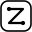

# Prior-Art Disclosures — SZL Holdings

<!-- CII-BEST-PRACTICES-BADGE: PENDING — replace 'PENDING' with the project id once founder registers this repo at https://bestpractices.coreinfrastructure.org/ -->

Public, timestamped defensive technical disclosures establishing prior art for the
PURIQ agentic-AI architecture. Publishing these methods places them in the public
record so they cannot be exclusively claimed by third parties.

## Contents

| File | Status on main, measured 2026-10-30 |
|------|-------------|
| `README.md` | Present. This note. |
| `main.tex` | UNAVAILABLE. GitHub contents returned 404. |
| `main.pdf` | UNAVAILABLE. GitHub contents returned 404. |
| `IEEEtran.cls` | UNAVAILABLE. GitHub contents returned 404. |

The formula text below is the text of this note. It is not a fetched PDF, and it is not a Lean proof.

## External kernels

SZL's own locked checks run on systems other people built. Those systems stay cited in `CITATION.cff`.

- Lean 4: Leonardo de Moura and Sebastian Ullrich, CADE 28, 2021. DOI 10.1007/978-3-030-79876-5_37.
- Supply-chain receipts: Santiago Torres-Arias, Hammad Afzali, Trishank Karthik Kuppusamy, Reza Curtmola, and Justin Cappos, USENIX Security 2019, pages 1393–1410.
- Quorum counting `n >= 3f+1`: Miguel Castro and Barbara Liskov, OSDI 1999.

The locked-eight registry `{F1, F4, F7, F11, F12, F18, F19, F22}` is SZL's own sorry-free Lean check. It does not make Lean, in-toto, or PBFT an SZL invention.

## Disclosure: PURIQ Master Formula, 13-Axis Yuyay Gate, Khipu DAG

- **Disclosure date:** 2026-06-01 (EDT)
- **Concept DOI chain:** [10.5281/zenodo.19944926](https://doi.org/10.5281/zenodo.19944926)
- **Replay-hash anchor:** `bacf54434f1a3bf2d758b27a62d5fd580ca4c8d3b180693573eeebcaea631fc5`

This disclosure publicly documents:

1. The PURIQ **master action-selection formula** `P(x,t) = argmax_a [ Λ(x) · Yuyay₁₃(a) · exp(−β·HUKLLA(a)) · ∏ᵢ Khipuᵢ(a) ]`.
2. The **13-axis Yuyay gate** — a conjunctive admissibility test (2 sacred axes ≥0.95, 7 structural ≥0.90, 4 introspection axes).
3. The **Khipu DAG** — a SHA-256 hash-chained receipt structure giving per-action provenance and an O(1) integrity tripwire (HUKLLA T01).

### Honest status

- Formal corpus: 749 Lean declarations, 14 unique axioms, **13 sorry-free (PROVED) theorems**, 163 raw sorries (open obligations), 23 extracted formulas.
- Λ-uniqueness is stated as **Conjecture 1**, not a theorem.
- Provenance level asserted: **SLSA L1** (honest).
- Load demonstration: 5.35M receipt writes/min; 100% chain-integrity tripwire on 504/504 injected corruptions.

## Reproducing the PDF

The LaTeX source and the compiled PDF are not in this tree. The `pdflatex` command cannot be run from the files that are here.

---

*Prepared by Yachay (Evaluation & Defense), on behalf of SZL Holdings.*

## SZL Holdings

*Amaru — the Inca avatar of SZL Holdings. Animated mark (400×400, 16fps loop). Signed Yachay.*
